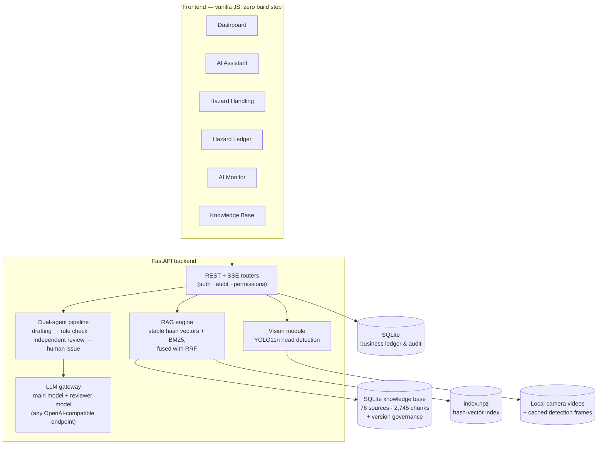

<div align="center">

# 🏗️ Construction Safety Workbench

**Grounded AI for construction site safety — every answer traceable to a source clause, every hazard human-verified.**

[](https://github.com/alinj4253-droid/construction-safety-workbench/actions/workflows/ci.yml)
[](https://www.python.org/)
[](https://fastapi.tiangolo.com/)
[](LICENSE)
[](#-quick-start)

A full-stack, offline-capable safety management platform that combines a **RAG assistant grounded in real regulations**, a **dual-agent hazard-handling pipeline**, and **real YOLO helmet detection** — built around a hard rule: *AI never has the final say*.

[中文文档](README_zh-CN.md) · [Quick Start](#-quick-start) · [Demo](#-demo) · [Architecture](#%EF%B8%8F-architecture)


</div>

---

## 📖 Contents

- [Why this project](#why-this-project)
- [Core features](#-core-features)
- [Demo](#-demo)
- [Architecture](#%EF%B8%8F-architecture)
- [Quick Start](#-quick-start)
- [Usage examples](#-usage-examples)
- [Verified results](#-verified-results)
- [Honest capability boundaries](#-honest-capability-boundaries)
- [Project structure](#-project-structure)
- [Roadmap](#-roadmap)
- [Contributing](#-contributing)
- [License](#-license)

## Why this project

Most "AI + safety" demos hallucinate clauses and auto-create hazard records. This project takes the opposite stance — it is built around three non-negotiable product rules:

1. **AI does not invent clauses.** Every assistant answer must cite retrievable source text from a governed knowledge base (76 curated regulation/case sources, 2,745 retained chunks). With no grounds, the assistant refuses.
2. **Detection is not a ledger entry.** Real YOLO snapshots only become *pending clues*; a human must confirm on-site before anything enters the hazard ledger. Dismissals are logged too.
3. **Documents require human sign-off.** A dual-agent pipeline (drafting → rule check → independent review, max one rework) produces a document, but only a human issue action makes it effective — each issued document freezes a citation snapshot.

The result is a realistic safety-ops tool: six working pages, full audit trails, honest offline fallbacks, and a Chinese-language knowledge base of national standards (JGJ 80, GB 55034-2022, JGJ/T 46…), Fujian/Xiamen local regulations and accident/enforcement cases.

## ✨ Core features

| Module | What it does |
|---|---|
| 📊 **Dashboard (P1)** | Today's to-dos, overdue-first queue, four quick entries, AI-monitor overview |
| 💬 **AI Safety Assistant (P2)** | Streaming RAG Q&A with clickable citation chips that open the original clause; three draft types (JSA / safety briefing / daily log); short-term context + explicit long-term memory; session history |
| 🛠️ **Hazard Handling (P6)** | Dual-agent workflow: Agent A drafts → rule check → Agent B independently reviews → human issues; every step persisted, idempotent signing, no duplicate hazards |
| 📋 **Hazard Ledger (P3)** | Light track (confirm → rectifying → closed) and heavy track (rectify → rectifying → re-check → closed) with re-work loops, derived overdue flags, evidence chain per record, CSV/Excel export |
| 🎥 **AI Monitor (P4)** | YOLO11n head detection (helmet on / off) on four local cameras with cached frame-by-frame detection playback; snapshots → human confirm/dismiss → ledger; per-camera applicability notes |
| 📚 **Knowledge Base (P5)** | Upload → pending review → verified workflow; version relations (obsoletes/replaces) checked locally; obsolete clauses (e.g. JGJ 80 articles superseded by GB 55034-2022) are intercepted at citation time |

Plus: PBKDF2-salted accounts with role-based permissions (safety officer / director views), SQLite audit trail, SSE streaming, and a **fully functional offline mode** (`LLM_ENABLED=0`) where retrieval, drafting and rule checks keep working while the UI labels exactly which parts are not model-backed.

## 🎬 Demo

All recordings are real interactions against a seeded demo database ([recorded by this script](scripts/record_readme_demo.py)) — nothing is mocked.

**AI Safety Assistant — grounded answer with citation chips**


*(Static fallback: [docs/assets/ai-assistant.png](docs/assets/ai-assistant.png))*

**AI Monitor — YOLO detection playback on local site footage**


*(Static fallback: [docs/assets/monitor-yolo.png](docs/assets/monitor-yolo.png))*

**Dashboard**


**Hazard ledger — evidence chain detail**


## 🏗️ Architecture



**Tech stack**

| Layer | Choice |
|---|---|
| Backend | Python 3.11 · FastAPI · Uvicorn · Pydantic v2 |
| Storage | SQLite (WAL, foreign keys, backup API) + NumPy hash-vector index |
| Retrieval | Stable hash embeddings + BM25 as independent recall channels, fused with Reciprocal Rank Fusion (no pretrained embeddings claimed) |
| Frontend | Vanilla JS/CSS/HTML — no framework, no build step, fully local assets |
| AI | OpenAI-compatible LLM gateway (e.g. DeepSeek for drafting, a second model for independent review) · Ultralytics YOLO11n (optional, local) |
| Documents | python-docx / openpyxl / pypdf |
| Testing | 81 pytest test cases + browser QA harness (headless Chrome via CDP) |

## 🚀 Quick Start

**Prerequisites:** Python 3.11. No database server, no Node, no build step.

```bash
git clone https://github.com/alinj4253-droid/construction-safety-workbench.git
cd construction-safety-workbench

python -3.11 -m venv .venv
# Windows: .venv\Scripts\python.exe -m pip install -r requirements.txt
# Linux/macOS:
python3.11 -m pip install -r requirements.txt

cp .env.example .env    # optional — add an OpenAI-compatible key, or leave it and run offline
```

Run (or use `start.bat` / `start.ps1` on Windows):

```bash
uvicorn backend.app.main:app --host 127.0.0.1 --port 8010
```

Open **http://127.0.0.1:8010** and sign in:

| Account | Role | Password |
|---|---|---|
| `AQ20260001` | Safety officer (handle, issue, rectify, re-check) | `123456` |
| `AQ20260003` | Project safety director (view, supervise, review KB) | `123456` |

Without an LLM key the system runs offline: retrieval, drafting templates and rule checks keep working, and the UI clearly labels which capabilities are not model-backed.

<details>
<summary><b>Building the knowledge index & seeding data on a fresh clone</b></summary>

The repo ships the raw knowledge sources (Chinese regulations, standards and cases under `施工安全RAG知识源/`). To rebuild the local SQLite store and retrieval index:

```bash
python -m backend.app.db              # create schema + seed demo hazards
python -m backend.rag.knowledge       # rebuild retrieval index (first run needs PyMuPDF: pip install pymupdf)
```

For PDF source rendering and RAR extraction helpers see `scripts/render_source_pdfs.py` and `scripts/extract_local_standards.py`. To create an isolated demo store: `python -m scripts.prepare_seed --output backend/data/new-demo.db`, then point `APP_DB` at it.

</details>

<details>
<summary><b>Optional: AI vision detection</b></summary>

Helmet detection runs locally with Ultralytics YOLO11n. Place trained weights at `construction-safety-inspection/models/helmet_yolo11n/weights/best.pt` and local camera clips under `videos/` (see `backend/vision/detector.py` for camera definitions). Prepare the frame-by-frame cache with `python -m scripts.prepare_monitor_playback`. Without these files, every other feature keeps working and the monitor page states exactly what is missing. Training utilities live in `construction-safety-inspection/scripts/`.

</details>

**Run the test suite**

```bash
pytest backend/tests -q
```

## 💬 Usage examples

**Grounded Q&A (assistant refuses without grounds):**

```
Q: 基坑临边防护有什么要求？        (What are the edge-protection requirements for foundation pits?)
A: → retrieved clauses with citation chips:
   JGJ80-2016 · 4.3.1  (current, verified)
   GB55034-2022 · 3.2.3
   ...each chip opens the exact source paragraph
```

```
Q: 火星量子计算机维修              (an ungrounded question)
A: 未检索到相关依据 — refused, no invented content.
```

**Hazard lifecycle (heavy track):** register → AI dual-agent drafting & independent review → **human issue** (idempotent, links the existing hazard) → rectifying → submit rectification → re-check → closed. Overdue is a derived flag computed per Asia/Shanghai deadline and never overrides the business state.

**Monitor flow:** YOLO snapshot → appears as *pending clue* (never auto-entered) → on-site human confirmation with note → becomes a light-track hazard; or dismissal with reason, logged, no ledger entry.

## ✅ Verified results

All evidence is committed under `artifacts/` — JSON results and screenshots produced by the QA harness, not hand-written claims.

- **81 pytest test cases** across auth, chat context, dashboard, demo reset, E2E, hazard feedback, identity, KB, memory, monitor playback, RAG and DB (`backend/tests/`).
- **5 end-to-end business scenarios** with persisted evidence (`artifacts/e2e-results.json`), including an induced-rework case executed in an isolated environment with explicitly marked test data.
- **Per-page browser acceptance** via headless Chrome CDP (`scripts/browser_p1..p6.py`): login/permissions, streaming Q&A, citation lookup, dual-track ledger, snapshot confirm/dismiss, KB version governance — each page has a JSON + screenshot in `artifacts/`.
- **Helmet detection model** (YOLO11n, two head classes): mAP50 ≈ **0.761**, precision ≈ **0.827**, recall ≈ **0.698** on its historical training validation set — reported in-app with the caveat that this is *not* live-site accuracy.
- Knowledge base: **76 registered sources / 2,745 retained chunks**, parse and review status tracked per source.

## 🧭 Honest capability boundaries

This project deliberately labels what it is *not*:

- No RTSP / live-stream ingestion — the monitor works on local video files with offline frame-by-frame detection playback ("本地回放" labeled in the UI).
- Reflective-vest detection is demo data; the vest model is untrained and labeled as such. Dashboard on-site headcount (87) is a demo value, not real access-control data.
- Helmet head-count is not a person count; detection timestamps differ from recording timestamps.
- RAG uses hash vectors + BM25 with RRF fusion — complex cross-clause reasoning is intentionally limited rather than improvised.
- No SMS notifications, no real gate integration, single-project local accounts; production deployment needs account management, TLS and operational backup.
- The UI, knowledge base and regulation corpus are in Chinese (the domain it targets).

## 📁 Project structure

```
├── backend/                  FastAPI app: routers, RAG, agents, vision, tests
│   ├── app/                  API: dashboard, chat, hazards, handle, monitor, kb, security, memory
│   ├── agents/               Dual-agent handling logic
│   ├── rag/                  Knowledge ingestion, retrieval, index
│   ├── vision/               YOLO detector + offline playback cache
│   └── tests/                81 pytest test cases
├── frontend/                 Zero-build vanilla JS/CSS/HTML (6 pages)
├── scripts/                  QA harness (browser CDP), demo seeding, GIF recorder, utilities
├── construction_safety_rag/  Standalone RAG prototype (graph + original pipeline, kept as baseline)
├── construction-safety-inspection/  Detection prototype: training scripts, val runs, demo assets
├── 施工安全RAG知识源/          Raw knowledge sources (regulations, standards, cases)
├── docs/                     Delivery report, review log, README assets
└── artifacts/                Machine-generated QA evidence (JSON/XML/screenshots)
```

## 🗺️ Roadmap

- [ ] RTSP / live-stream ingestion for real-time monitoring
- [ ] Train and integrate the reflective-vest detection model
- [ ] Multi-project & organization accounts
- [ ] English UI alongside the Chinese domain content
- [ ] Docker image for one-command deployment

## 🤝 Contributing

Issues and PRs are welcome. Please keep the project's three product rules intact (no invented clauses, no auto-entered hazards, no auto-effective documents) — proposals that change them should be discussed in an issue first.

```bash
pytest backend/tests -q      # make sure the suite passes before submitting
```

## 📷 Recording your own demo

`scripts/record_readme_demo.py` drives a headless-Chrome session against an isolated demo database and writes frames to `artifacts/tmp/gif-frames/`; assemble with any GIF encoder. It never touches a production database.

## License

Released under the [MIT License](LICENSE). Demo site footage comes from [Pexels](https://www.pexels.com/) (free to use). Regulation texts remain the property of their respective issuers and are included solely for retrieval demonstration.

---

<div align="center">
<sub>中文文档：[README_zh-CN.md](README_zh-CN.md)</sub>
</div>
