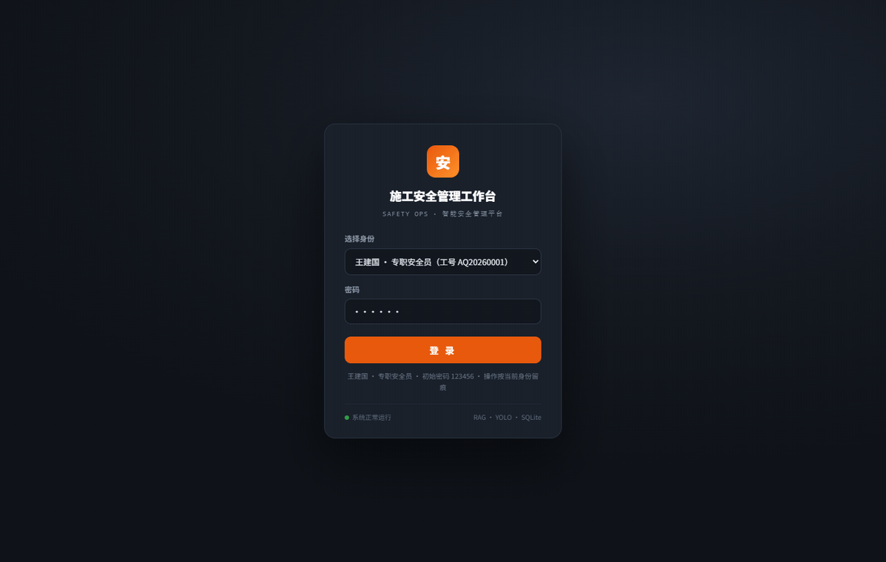
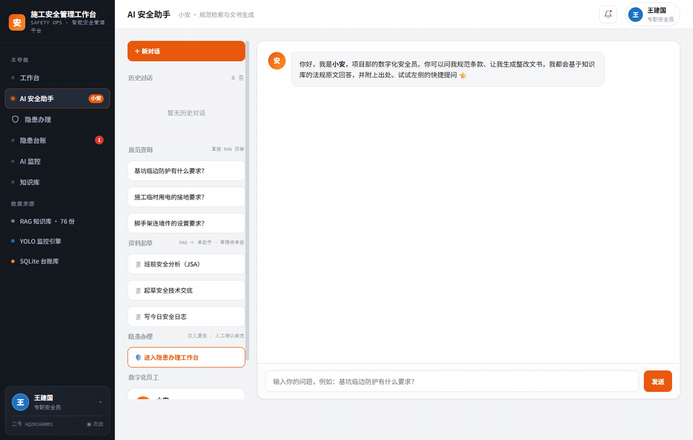
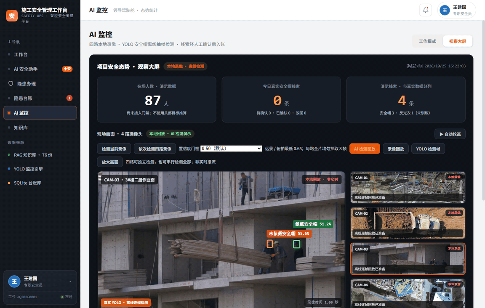
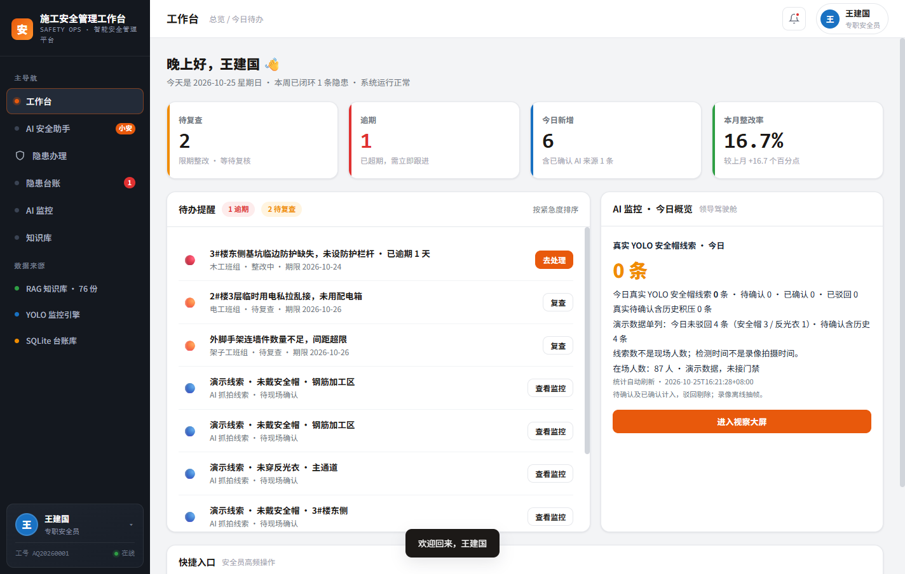
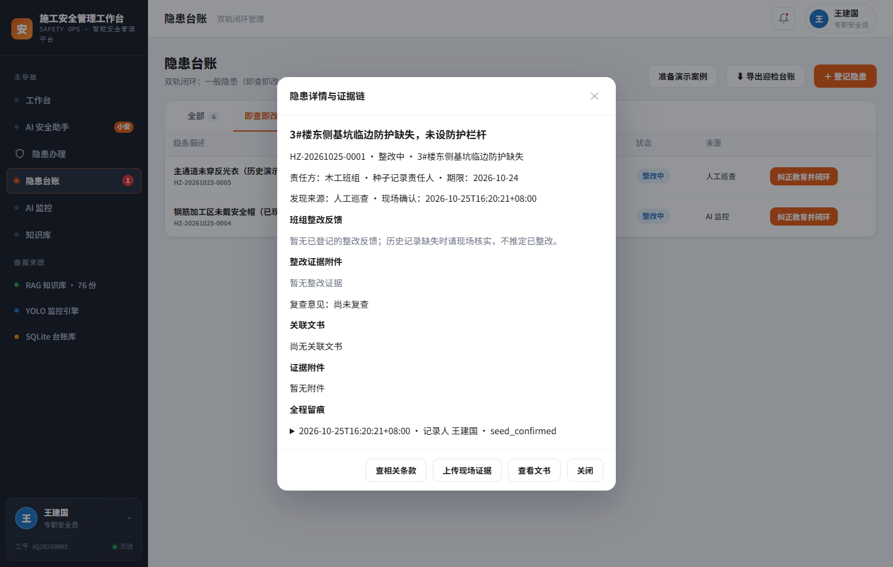
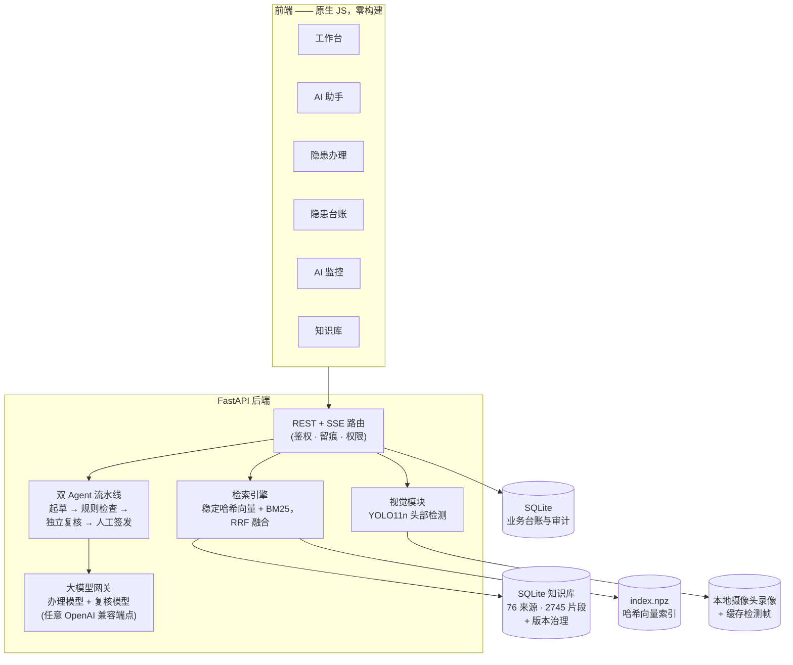

<div align="center">

# 🏗️ 施工安全管理工作台 (Construction Safety Workbench)

**有据可查的施工安全 AI —— 每个回答可溯源到规范条款，每条隐患必须人工确认。**

[](https://github.com/alinj4253-droid/construction-safety-workbench/actions/workflows/ci.yml)
[](https://www.python.org/)
[](https://fastapi.tiangolo.com/)
[](LICENSE)

FastAPI + SQLite 全栈安全管理平台：**基于真实规范的 RAG 助手**、**双 Agent 隐患办理流水线**、**真实 YOLO 安全帽检测**，并坚守一条硬规则：*AI 永远没有最终决定权*。

[English](README.md) · [快速开始](#-快速开始) · [演示](#-演示) · [系统架构](#%EF%B8%8F-系统架构)



</div>

---

## 目录

- [项目定位](#项目定位)
- [核心功能](#-核心功能)
- [演示](#-演示)
- [系统架构](#%EF%B8%8F-系统架构)
- [快速开始](#-快速开始)
- [使用示例](#-使用示例)
- [已验证结果](#-已验证结果)
- [如实标注的能力边界](#-如实标注的能力边界)
- [项目结构](#-项目结构)
- [Roadmap](#-roadmap)
- [参与贡献](#-参与贡献)
- [许可证](#-许可证)

## 项目定位

多数"AI + 安全"演示会编造条款、自动生成台账。本项目反其道而行，围绕三条不可违背的产品规则构建：

1. **AI 不编造条款。** 助手每个回答都必须引用知识库中可检索的原文（76 份精选法规/案例来源、2745 条保留片段）；没有依据时明确拒答。
2. **检测不等于入账。** 真实 YOLO 抓拍只生成*待确认线索*，必须人工现场确认才进入隐患台账；驳回同样留痕。
3. **文书必须人工签发。** 双 Agent 流水线（起草 → 规则检查 → 独立复核，最多返工一次）产出文书，但只有人工签发才生效——每份签发文书冻结引用快照。

最终得到一个贴近真实安全运营的工具：六个可用页面、完整操作留痕、如实的离线兜底，以及覆盖国家标准（JGJ 80、GB 55034-2022、JGJ/T 46…）、福建/厦门地方规定与事故执法案例的中文知识库。

## ✨ 核心功能

| 模块 | 功能 |
|---|---|
| 📊 **工作台 (P1)** | 今日待办、逾期优先队列、四个快捷入口、AI 监控总览 |
| 💬 **AI 安全助手 (P2)** | 流式 RAG 问答，引用芯片可点开定位原文条款；三类草稿（JSA / 安全交底 / 安全日志）；短期上下文 + 显式长期记忆；历史会话 |
| 🛠️ **隐患办理 (P6)** | 双 Agent 流程：Agent A 起草 → 规则检查 → Agent B 独立复核 → 人工签发；每步落库、幂等签发、不重复创建隐患 |
| 📋 **隐患台账 (P3)** | 轻轨（确认→整改中→闭环）与重轨（整改→整改中→复查→销项）双状态机，支持退回；逾期为派生标记；单条证据链；CSV/Excel 导出 |
| 🎥 **AI 监控 (P4)** | YOLO11n 头部检测（佩戴/未佩戴安全帽），四路本地录像 + 缓存逐帧检测回放；抓拍 → 人工确认/驳回 → 台账；每路摄像头标注适用性 |
| 📚 **知识库 (P5)** | 上传 → 待核验 → 生效流程；本地登记版本关系（废止/替代）；引用时拦截已废止条款（如 GB 55034-2022 公告废止的 JGJ 80 部分条文） |

另含：PBKDF2 加盐账号与角色权限（安全员 / 总监视角）、SQLite 操作留痕、SSE 流式输出，以及**完整可用的离线模式**（`LLM_ENABLED=0`）——检索、模板起草、规则复核照常工作，界面如实标注哪些能力未经模型。

## 🎬 演示

以下均为对种子演示库的真实操作录制（[录制脚本](scripts/record_readme_demo.py)），无任何摆拍。

**AI 安全助手 —— 带引用芯片的有据回答**



*(静态备图：[docs/assets/ai-assistant.png](docs/assets/ai-assistant.png))*

**AI 监控 —— 本地工地录像上的 YOLO 检测回放**



*(静态备图：[docs/assets/monitor-yolo.png](docs/assets/monitor-yolo.png))*

**工作台**



**隐患台账 —— 证据链详情**



## 🏗️ 系统架构



**技术栈**

| 层 | 选型 |
|---|---|
| 后端 | Python 3.11 · FastAPI · Uvicorn · Pydantic v2 |
| 存储 | SQLite（WAL、外键、备份 API）+ NumPy 哈希向量索引 |
| 检索 | 稳定哈希向量与 BM25 双通道召回，RRF 融合（不伪称预训练语义嵌入） |
| 前端 | 原生 JS/CSS/HTML —— 无框架、无构建步骤、资源全本地 |
| AI | OpenAI 兼容大模型网关（如 DeepSeek 起草 + 第二模型独立复核） · Ultralytics YOLO11n（可选，本地运行） |
| 文书 | python-docx / openpyxl / pypdf |
| 测试 | 81 项 pytest 用例 + 无头 Chrome CDP 浏览器验收 |

## 🚀 快速开始

**环境要求：** Python 3.11。无需数据库服务、无需 Node、无需构建。

```powershell
git clone https://github.com/alinj4253-droid/construction-safety-workbench.git
cd construction-safety-workbench

py -3.11 -m venv .venv
.venv\Scripts\python.exe -m pip install -r requirements.txt

Copy-Item .env.example .env   # 可选 —— 填入 OpenAI 兼容密钥；不填可离线运行
```

启动（Windows 也可直接运行 `start.ps1` 或 `start.bat`）：

```powershell
.venv\Scripts\python.exe -m uvicorn backend.app.main:app --host 127.0.0.1 --port 8010
```

浏览器打开 **http://127.0.0.1:8010**，使用演示账号登录：

| 工号 | 角色 | 初始密码 |
|---|---|---|
| `AQ20260001` | 专职安全员（办理、签发、整改、复查） | `123456` |
| `AQ20260003` | 项目安全总监（查看、督办、知识库审核） | `123456` |

不配置密钥即离线运行：检索、起草模板、规则复核照常可用，界面会明确标注未接入模型的部分。

<details>
<summary><b>全新克隆时重建知识索引与种子数据</b></summary>

仓库自带原始知识源（`施工安全RAG知识源/` 下的法规、标准与案例）。重建本地 SQLite 库与检索索引：

```powershell
.venv\Scripts\python.exe -m backend.app.db          # 建库 + 种子隐患
.venv\Scripts\python.exe -m backend.rag.knowledge   # 重建检索索引（首次需 PyMuPDF：pip install pymupdf）
```

PDF 渲染与 RAR 解包辅助脚本见 `scripts/render_source_pdfs.py`、`scripts/extract_local_standards.py`。制作独立演示库：`python -m scripts.prepare_seed --output backend/data/new-demo.db`，再用 `APP_DB` 指向它。

</details>

<details>
<summary><b>可选：AI 视觉检测</b></summary>

安全帽检测使用本地 Ultralytics YOLO11n。将训练权重放在 `construction-safety-inspection/models/helmet_yolo11n/weights/best.pt`，本地录像放在 `videos/`（摄像头定义见 `backend/vision/detector.py`），并用 `python -m scripts.prepare_monitor_playback` 生成逐帧缓存。缺少这些文件时其余功能照常可用，监控页会如实说明缺失项。训练工具位于 `construction-safety-inspection/scripts/`。

</details>

**运行测试**

```powershell
.venv\Scripts\python.exe -m pytest backend/tests -q
```

## 💬 使用示例

**有据问答（无依据时拒答）：**

```
问：基坑临边防护有什么要求？
答：→ 检索条款 + 引用芯片：
   JGJ80-2016 · 4.3.1（现行 · 已核验）
   GB55034-2022 · 3.2.3
   ……每个芯片可点开定位到原文段落
```

```
问：火星量子计算机维修
答：未检索到相关依据 —— 明确拒答，不编造内容。
```

**隐患生命周期（重轨）：** 登记 → AI 双 Agent 起草与独立复核 → **人工签发**（幂等、关联原隐患）→ 整改中 → 提交整改 → 复查 → 销项。逾期按上海时区截止日派生，不覆盖业务状态。

**监控流程：** YOLO 抓拍 → 待确认线索（绝不自动入账）→ 人工现场确认并填写记录 → 生成轻轨隐患；误报驳回留痕、不入台账。

## ✅ 已验证结果

全部证据提交在 `artifacts/`——由 QA 工具产生的 JSON 结果与截图，非人工撰写。

- **81 项 pytest 用例**：覆盖鉴权、对话上下文、工作台、演示重置、端到端、隐患反馈、身份、知识库、记忆、监控回放、RAG 与数据库（`backend/tests/`）。
- **5 条端到端业务场景**，证据落盘（`artifacts/e2e-results.json`），含隔离环境显式注入错误期限的返工场景，测试数据均有标识。
- **逐页浏览器验收**（无头 Chrome CDP，`scripts/browser_p1..p6.py`）：登录与权限、流式问答、引用定位、双轨台账、抓拍确认/驳回、知识库版本治理——每页 JSON + 截图在 `artifacts/`。
- **安全帽检测模型**（YOLO11n，两类头部）：历史训练验证集 mAP50 ≈ **0.761**、precision ≈ **0.827**、recall ≈ **0.698**——界面同步提示这不等于现场准确率。
- 知识库：**76 份登记来源 / 2745 条保留片段**，逐来源跟踪解析与核验状态。

## 🧭 如实标注的能力边界

- 未接 RTSP/实时流——监控基于本地录像文件做离线逐帧检测回放（界面标注"本地回放"）。
- 反光衣线索为演示数据，模型未训练并如实标注；工作台在场 87 人为演示值，非真实门禁数据。
- 头部计数不是现场人数；检测时间不是录像拍摄时间。
- RAG 为哈希向量 + BM25 的 RRF 融合，复杂跨条款解释能力有限，不即兴发挥。
- 未接短信、真实门禁；本地单项目账号；正式部署需账号管理、TLS 与运维备份。
- 界面、知识库与法规语料为中文（面向中文施工行业）。

## 📁 项目结构

```
├── backend/                  FastAPI 应用：路由、RAG、Agent、视觉、测试
│   ├── app/                  API：工作台、问答、隐患、办理、监控、知识库、鉴权、记忆
│   ├── agents/               双 Agent 办理逻辑
│   ├── rag/                  知识入库、检索、索引
│   ├── vision/               YOLO 检测器 + 离线回放缓存
│   └── tests/                81 项 pytest 用例
├── frontend/                 零构建原生 JS/CSS/HTML（6 页）
├── scripts/                  QA 工具（浏览器 CDP）、演示种子、GIF 录制、辅助脚本
├── construction_safety_rag/  独立 RAG 原型（图谱 + 原始管线，作为基线保留）
├── construction-safety-inspection/  检测原型：训练脚本、验证集曲线、演示素材
├── 施工安全RAG知识源/          原始知识源（法规、标准、案例）
├── docs/                     交付报告、审读记录、README 素材
└── artifacts/                机器生成的 QA 证据（JSON/XML/截图）
```

## 🗺️ Roadmap

- [ ] RTSP / 实时流接入，实现真正实时监控
- [ ] 训练并接入反光衣检测模型
- [ ] 多项目与组织级账号
- [ ] 中文之外增加英文界面
- [ ] Docker 镜像一键部署

## 🤝 参与贡献

欢迎 Issue 与 PR。请保留项目三条产品原则（AI 不编造条款；抓拍必须人工确认才入台账；文书必须人工签发才生效）——改变这三条的想法请先开 Issue 讨论。

```powershell
.venv\Scripts\python.exe -m pytest backend/tests -q      # 提交前确保测试通过
```

## 📷 自行录制演示

`scripts/record_readme_demo.py` 会对隔离演示库驱动无头 Chrome 会话，帧输出到 `artifacts/tmp/gif-frames/`，再用任意 GIF 编码器合成。不会触碰生产数据库。

## 许可证

以 [MIT License](LICENSE) 发布。演示工地视频来自 [Pexels](https://www.pexels.com/)（可自由使用）。法规文本版权归原作者所有，仅作检索演示用途。

---

<div align="center">
<sub>English documentation: [README.md](README.md)</sub>
</div>
